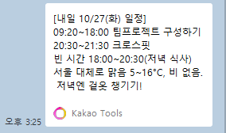

# schedule-planner

자연어로 일정·할 일을 등록하고, 날씨·공휴일·빈 시간을 고려해 하루를 배치해 주는 Claude Code 플러그인.

## 구성
| 구성요소 | 위치 | 역할 |
|---|---|---|
| MCP 서버 | `server/planner_server.py` | 날씨(Open-Meteo), 공휴일(Nager.Date), 빈 시간 계산, 할 일 배치 제안 |
| Skill | `skills/schedule-planner` | 등록·브리핑·배치·나챗방 전송 절차 |
| Agent | `agents/planner.md` | 여러 날·다수 할 일의 배치 계획 |
| Hook | `hooks/validate-event.js` | 톡캘린더 일정 등록 전 시간 값 검증(과거·역전·5분 단위) |

외부 OpenAPI는 API 키가 필요 없습니다. 일정·할 일·나챗방은 PlayMCP(톡캘린더, 투두메이트, 나챗방) 커넥터를 사용하므로 claude.ai에 연결되어 있어야 합니다.

## 사용
```powershell
claude --plugin-dir C:\Users\Woori\Desktop\wori\schedule-planner
```
예: "내일 일정 브리핑해줘", "이번 주 목요일 빈 시간에 운동 1시간, 공부 2시간 배치해줘"

## 실행 결과
"내일 팀프로젝트 09:20~18:00, 크로스핏 20:30~21:30 등록하고 브리핑해줘"를 요청한 결과입니다.

| 톡캘린더 등록 | 나챗방 브리핑 |
|---|---|
|  |  |

## 요구사항
- Python 3.11 + `mcp` (`.mcp.json`의 `command`는 conda `py311` 경로로 고정됨 — 환경이 다르면 수정)
- Node.js (훅)

## 테스트
```powershell
sh tests/test_hook.sh
python -m pytest tests/test_server.py
```
